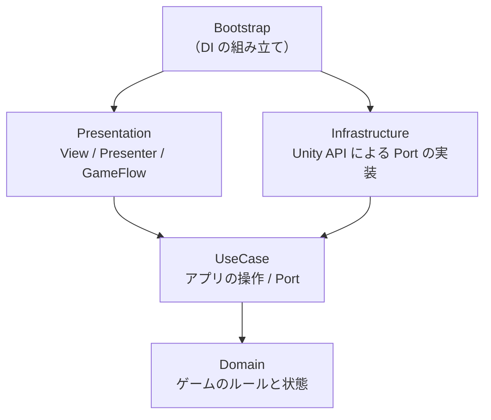

# Unity Project Starter

[](https://github.com/orquvia/unity-project-starter/actions/workflows/unity-tests.yml)

ORQUVIA が Unity 開発の土台として使う、**層構造・DI・非同期処理・自動テストを一通り備えたスタータープロジェクト**です。

題材は「制限時間内にボタンを押してスコアを稼ぐ」だけの小さなゲームです。ゲーム自体ではなく、**機能が増えても構造が崩れない仕組み**を示すことを目的にしています。そのため、このリポジトリでは実装と同じくらい「なぜそう設計したか」の説明を重視しています。

```
Title ──[Start]──▶ Game（20秒）──[時間切れ]──▶ Result ──[Title]──▶ Title
```

## 設計の要点

| | 内容 | 詳細 |
|---|---|---|
| 層と依存方向 | Domain / UseCase / Presentation / Infrastructure / Bootstrap を asmdef で分け、依存の向きをコンパイラに強制させている。さらにビルド後のアセンブリの参照をテストで検査している | [architecture.md](docs/architecture.md) |
| 状態の書き込み経路 | ゲーム状態を変更できるのは UseCase だけ。Presentation は読み取り専用のインターフェースしか受け取れず、変更メソッドは `internal` なので呼び出すことも不可能 | [architecture.md](docs/architecture.md#usecase-を分ける理由) |
| DI スコープ | シーンをまたぐ状態はルートの `LifetimeScope`、画面ごとの View と Presenter はシーンの `LifetimeScope` に置く。Presenter は MonoBehaviour にしない | [dependency-injection.md](docs/dependency-injection.md) |
| 非同期とキャンセル | 画面遷移は `GameFlow` に集約。二重遷移の防止、アプリ終了時のキャンセル、想定外の例外をそれぞれ区別して扱う | [async-and-cancellation.md](docs/async-and-cancellation.md) |
| テスト | 層の依存チェック、ロジックの単体テスト、DI 構成のテスト、実際のシーンを通す E2E テストの4種類。GitHub Actions で毎回実行する | [testing.md](docs/testing.md) |

主な設計判断は [ADR](docs/adr/README.md) として、検討した他の選択肢と一緒に記録しています。

## 構成図



矢印は asmdef の参照（依存）の向きです。Domain と UseCase は UnityEngine にも依存しません。

## 技術スタック

| | バージョン |
|---|---|
| Unity | 6000.3.26f1（URP 17.3） |
| [VContainer](https://github.com/hadashiA/VContainer) | 1.19.0 |
| [UniTask](https://github.com/Cysharp/UniTask) | 2.5.11 |
| Unity Test Framework | 1.6.0 |
| CI | GitHub Actions + [GameCI](https://game.ci/)（`unity-test-runner@v4`） |

## 動かし方

1. Unity Hub で `UnityProject/` を開きます（Unity 6000.3.26f1）。VContainer と UniTask は `Packages/manifest.json` から Git 経由で自動的に取得されます。
2. `Assets/Game/Scene/Title.unity` を開いて再生します。

ルートの DI 設定（`AppLifetimeScope`）は `VContainerSettings` から自動で読み込まれるので、どのシーンから再生しても動きます。

### テストの実行

**Window > General > Test Runner** から EditMode / PlayMode を実行します。

> [!NOTE]
> ローカルで PlayMode テストを実行すると、Test Runner が `ProjectSettings/ProjectSettings.asset` を書き換えます。この差分はコミットしないでください。

## ディレクトリ構成

```
UnityProject/Assets/Game/
├── Scene/                 Title / Game / Result
├── Settings/              AppLifetimeScope.prefab, VContainerSettings, GameConfigAsset
├── Scripts/
│   ├── Domain/            GameRules, GameSession（Unity 非依存）
│   ├── UseCase/           StartGame / HitTarget / AdvanceGame, Ports/
│   ├── Presentation/      各画面の View・Presenter, GameFlow, ITimeProvider
│   ├── Infrastructure/    UnitySceneNavigator, UnityGameLogger, GameConfigAsset
│   └── Bootstrap/         各 LifetimeScope（コンポジションルート）
└── Tests/
    ├── EditMode/          Architecture / Domain / Presentation / Infrastructure / Bootstrap
    └── PlayMode/          E2E
```

## ドキュメント

- [アーキテクチャ（層・asmdef・UseCase・Port）](docs/architecture.md)
- [DI とスコープ設計（VContainer）](docs/dependency-injection.md)
- [非同期処理とキャンセル](docs/async-and-cancellation.md)
- [テスト戦略と CI](docs/testing.md)
- [ADR（設計判断の記録）](docs/adr/README.md)

## ライセンス

[MIT](LICENSE)
