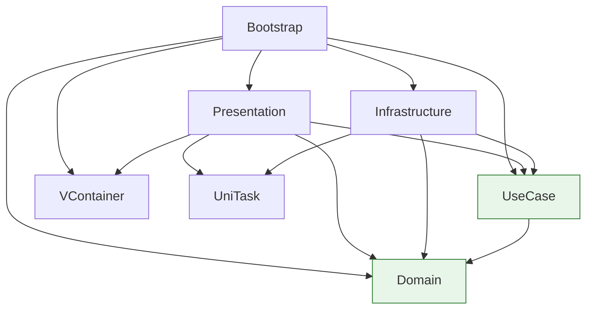
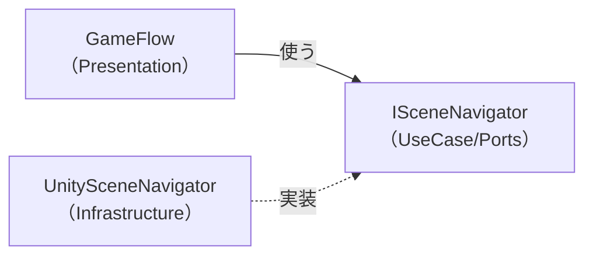
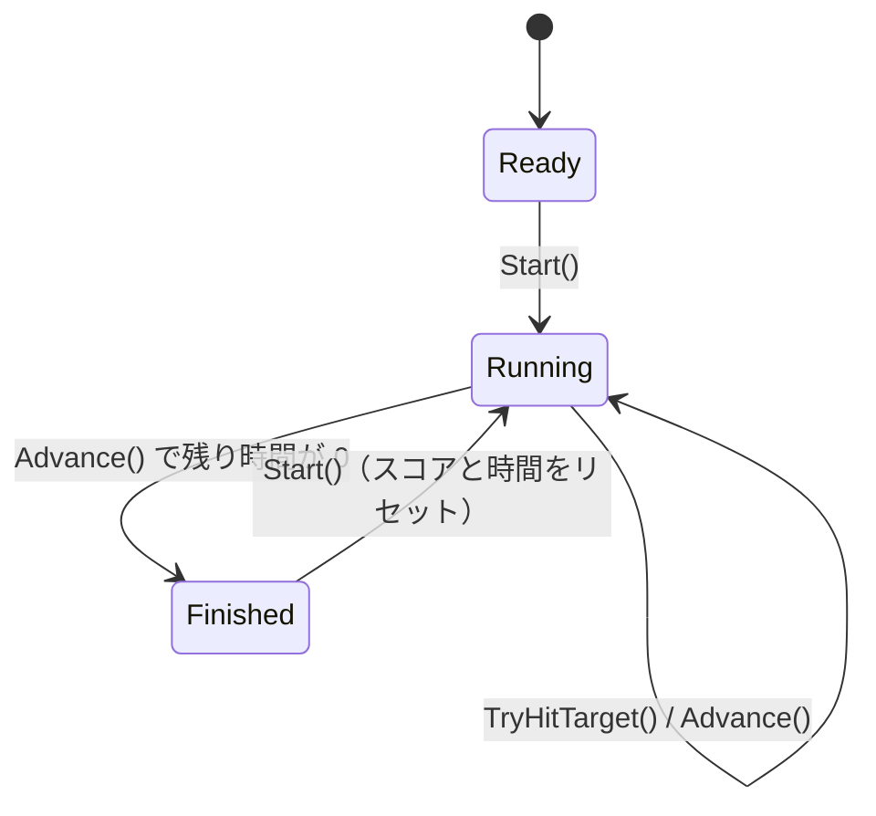

# アーキテクチャ

## 層の構成

コードを5つの層に分け、それぞれを asmdef（Assembly Definition）にしています。

| 層 | asmdef | 役割 | 置くもの |
|---|---|---|---|
| Domain | `Orquvia.Starter.Domain` | ゲームのルールと状態 | `GameRules`, `GameSession`, `GameStatus` |
| UseCase | `Orquvia.Starter.UseCase` | アプリとしての操作と、外部に求める機能のインターフェース（Port） | `StartGameUseCase` など, `ISceneNavigator`, `IGameLogger` |
| Presentation | `Orquvia.Starter.Presentation` | 画面の表示と入力、画面遷移 | 各 View / Presenter, `GameFlow`, `ITimeProvider` |
| Infrastructure | `Orquvia.Starter.Infrastructure` | Unity API を使った Port の実装、設定アセット | `UnitySceneNavigator`, `UnityGameLogger`, `GameConfigAsset` |
| Bootstrap | `Orquvia.Starter.Bootstrap` | 全体の組み立て（コンポジションルート） | 各 `LifetimeScope` |

## asmdef の依存関係



緑色の層（Domain と UseCase）は UnityEngine も外部ライブラリも参照しません。

### ルール

- **依存は内側に向かう。** Domain は何にも依存せず、UseCase は Domain だけに依存します。
- **Presentation と Infrastructure は互いを参照しない。** 画面の都合と Unity API の実装を独立して変更できるようにするためです。両者をつなぐのは UseCase 層の Port（インターフェース）です。
- **全層を参照してよいのは Bootstrap だけ。** 具体的な実装クラスをインターフェースに結びつけるのは、DI を組み立てる Bootstrap の役割です。

### asmdef の設定

| 設定 | 対象 | 意図 |
|---|---|---|
| `noEngineReferences: true` | Domain, UseCase | UnityEngine を参照できなくする。ロジックが純粋な C# になり、Unity なしで動き、テストも速い |
| `autoReferenced: false` | すべての asmdef | `Assembly-CSharp` など、asmdef を持たないコードから勝手に参照されないようにする |
| `references` を最小限に | すべての asmdef | 上の依存図にない参照を追加するとコンパイルが通らない |

### ルールをテストで守る

asmdef の参照は Inspector から簡単に追加できるので、レビューで見落とすと依存ルールは静かに崩れていきます。そこで [`LayerDependencyTests`](../UnityProject/Assets/Game/Tests/EditMode/Architecture/LayerDependencyTests.cs) で、**ビルド後のアセンブリが実際に参照しているアセンブリ**を検査しています。

```csharp
[Test]
public void UseCase_DependsOnlyOnDomain()
{
    AssertDependencies(
        typeof(StartGameUseCase).Assembly,
        "Orquvia.Starter.Domain");
}
```

asmdef ファイルの中身ではなくビルド結果を見るので、「参照は追加したが、まだ使っていない」状態では失敗せず、実際にコードが依存したときに失敗します。

## UseCase を分ける理由

UseCase は現状、どれも Domain のメソッドを1つ呼ぶだけの薄いクラスです。それでも層として分けているのには、次の理由があります。

### 1. 状態を変更できる経路を UseCase だけに絞る

`GameSession` は VContainer に2つの型で登録しています。

```csharp
builder.Register<GameSession>(Lifetime.Singleton)
    .AsSelf()
    .As<IReadOnlyGameSession>();
```

| 使う側 | 受け取る型 | できること |
|---|---|---|
| UseCase | `GameSession` | 状態の変更 |
| Presenter | `IReadOnlyGameSession` | 読み取りだけ（`Score`, `RemainingSeconds`, `Status`） |

さらに `GameSession` の変更メソッド（`Start`, `TryHitTarget`, `Advance`, `Reset`）は `internal` にし、`InternalsVisibleTo` で公開する先を UseCase とテストのアセンブリだけにしています（[`Domain/AssemblyInfo.cs`](../UnityProject/Assets/Game/Scripts/Domain/AssemblyInfo.cs)）。

そのため Presentation で `GameSession` を受け取ったとしても、状態を変えようとするとコンパイルエラーになります。取り決めではなくコンパイラで守られており、この設定が緩められていないことも [`DomainEncapsulationTests`](../UnityProject/Assets/Game/Tests/EditMode/Architecture/DomainEncapsulationTests.cs) で検査しています。詳しくは [ADR-0006](adr/0006-restrict-domain-mutation-to-usecase.md) を参照してください。

### 2. ユーザーの操作ごとに1クラス

`StartGameUseCase` / `HitTargetUseCase` / `AdvanceGameUseCase` は、それぞれ「ゲームを始める」「的を叩く」「時間を進める」という1つの操作に対応します。Presenter は必要な UseCase だけを注入されるので、そのクラスが何をできるかがコンストラクタを見るだけで分かります。

### 3. Domain にも画面にも属さない処理の置き場所

実際のゲームでは、「的を叩いたら」スコアを増やすだけでなく、効果音を鳴らす、分析ログを送る、記録を保存するといった処理が加わります。これらはゲームのルール（Domain）ではなく、画面の表示（Presentation）でもありません。UseCase を先に用意しておくと、こうした処理を Presenter や Domain に混ぜずに追加できます。

小さな題材に対しては大げさな構成ですが、このリポジトリは**機能が増えたときの置き場所を示すスターター**なので、あえて最初から分けています。

### 4. Unity のフレームから切り離す

`AdvanceGameUseCase.Execute(float deltaSeconds)` は経過時間を引数で受け取ります。`Time.deltaTime` を読むのは Presentation の `ITimeProvider` で、UseCase は「フレーム」という概念を知りません。そのため時間の進み方をテストで自由に決められます。

## Port の置き場所

`ISceneNavigator` と `IGameLogger` は UseCase 層の `Ports/` に置き、実装は Infrastructure にあります（依存性逆転）。



現状これらの Port を使っているのは UseCase ではなく Presentation の `GameFlow` です。それでも UseCase 層に置いているのは、**Presentation と Infrastructure の両方から参照できる場所が UseCase 層（か Domain 層）しかない**ためです。Infrastructure は Presentation を参照できないので、Port を Presentation に置くと Infrastructure から実装できません。Domain に置くのは、シーン遷移やログがゲームのルールではないので不適切です。

- `SceneId`（Title / Game / Result）は Port と同じ場所に置いています。シーンファイルのパスへの変換は Infrastructure の `UnitySceneNavigator.ToScenePath` だけが知っています。
- `ISceneNavigator.LoadAsync` が UniTask ではなく `Task` を返す理由は [非同期処理とキャンセル](async-and-cancellation.md#task-と-unitask-の使い分け) を参照してください。

### ITimeProvider だけは Presentation にある

`ITimeProvider` はインターフェースも実装（`UnityTimeProvider`）も Presentation にあります。フレームごとの経過時間を必要とするのは `GamePresenter` だけで、UseCase には引数として値を渡すからです。Port にする必要がなく、テストで差し替えるためだけのインターフェースです。

## Domain の設計

### GameRules：値を検証してから作る

`GameRules` は制限時間と1回あたりの得点を持つ不変のオブジェクトです。コンストラクタで値を検証し、不正な値（0以下、NaN、無限大）なら例外を投げます。不正な `GameRules` はそもそも作れないので、使う側では検証が不要です。

### ScriptableObject から Domain への変換

調整用の値は ScriptableObject（`GameConfigAsset`、Infrastructure 層）に置き、`ToRules()` で `GameRules` に変換してから DI に登録します。

```
GameConfigAsset（Inspector で編集） ──ToRules()──▶ GameRules（Domain）
```

Domain は ScriptableObject の存在を知りません。Inspector では `[Min]` 属性で入力ミスを防ぎ、コンストラクタの検証で最終的な正しさを保証する、二重の守りになっています。

### GameSession：状態遷移



- `TryHitTarget()` と `Advance()` は Running 以外では何もせず `false` を返します。
- `Advance()` は**このフレームで終了したときだけ** `true` を返します。Presenter はこれを「Result へ遷移する合図」として使います。
- スコアの加算は `checked` で行い、オーバーフローを黙って見過ごさないようにしています。

## 既知の制約

- **シーンロード失敗時に画面への通知がない。** ログを出し、次の遷移を受け付けるだけです。実運用ではリトライやエラー表示が必要です。
- **UI は uGUI の `Text`。** 題材を簡単にするためで、実際のプロジェクトでは TextMeshPro を使う想定です。
