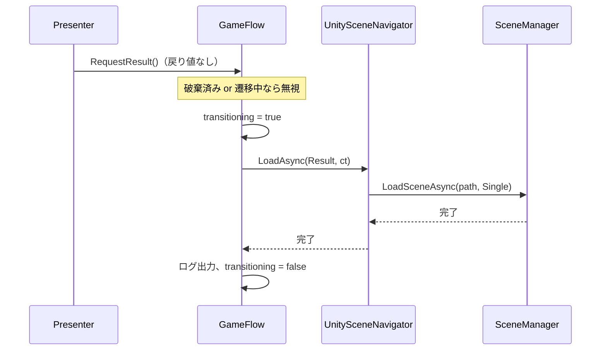

# 非同期処理とキャンセル

このプロジェクトで非同期処理が出てくるのはシーン遷移だけです。シーン遷移はすべて Presentation の [`GameFlow`](../UnityProject/Assets/Game/Scripts/Presentation/Flow/GameFlow.cs) を通すようにし、エラー処理とキャンセルを1か所にまとめています。

## 全体の流れ



Presenter は `RequestXxx()` を呼ぶだけで、完了を待たず、例外も受け取りません。遷移の失敗やキャンセルをどう扱うかは `GameFlow` が責任を持ちます。

## Task と UniTask の使い分け

```csharp
// UseCase/Ports/ISceneNavigator.cs
Task LoadAsync(SceneId sceneId, CancellationToken ct);
```

Port の戻り値は UniTask ではなく標準の `Task` にしています（[ADR-0003](adr/0003-task-at-port-boundary.md)）。

| 層 | 使う型 | 理由 |
|---|---|---|
| UseCase（Port の定義） | `Task` | UseCase 層を外部ライブラリに依存させない（`noEngineReferences` で、UniTask も参照していない） |
| Infrastructure（Port の実装） | UniTask で待って `Task` を返す | `AsyncOperation` を `CancellationToken` 付きで待つために UniTask の `WithCancellation` を使う |
| Presentation（`GameFlow`） | `UniTask` + `Forget()` | 投げっぱなしの非同期処理を UniTask の仕組みで扱う |

シーン遷移は一度きりの処理なので、`Task` の割り当てコストは問題になりません。毎フレーム呼ぶような処理の Port を追加する場合は、この判断を見直す必要があります。

## キャンセルの意味

`ISceneNavigator.LoadAsync` の `ct` は、**ロード完了を待つのをやめるためのもの**で、開始したシーンロードそのものは止まりません。Unity の `SceneManager.LoadSceneAsync` には途中で中止する API がないためです。この点はインターフェースのコメントにも明記しています。

### 誰がキャンセルするか

`GameFlow` 自身が `CancellationTokenSource` を持ち、`Dispose()` でキャンセルします。`GameFlow` はルートスコープの Singleton なので、`Dispose()` が呼ばれるのはアプリ終了時です。

```
アプリ終了 → ルートスコープの破棄 → GameFlow.Dispose() → _cts.Cancel()
                                                         └→ 待っていたロードの await が OperationCanceledException で終わる
```

Presenter ごとにトークンを渡す設計にしなかったのは、遷移を要求した画面は遷移によって破棄されるからです。シーンを抜けるたびにキャンセルされると、遷移そのものが成り立ちません。遷移は画面より長く生きる `GameFlow` が持つべき処理です。

## 例外の扱い

```csharp
try
{
    await _scenes.LoadAsync(destination, _cts.Token);
    _logger.Info($"Loaded scene: {destination}");
}
catch (OperationCanceledException)
    when (_cts.IsCancellationRequested)
{
    // GameFlow の破棄に伴うキャンセル。何もしない。
}
catch (Exception ex)
{
    _logger.Error("Scene transition failed", ex);
}
finally
{
    transitioning = false;
}
```

| ケース | 扱い |
|---|---|
| 正常に完了 | Info ログ |
| `GameFlow` の破棄によるキャンセル | 正常な終了処理なので何も出さない |
| 上記以外の `OperationCanceledException` | 想定外なので Error ログ |
| その他の例外（同期的に投げられたものも含む） | Error ログ。遷移中フラグを戻して、次の遷移を受け付ける |

`when (_cts.IsCancellationRequested)` の例外フィルターで、「自分が止めたキャンセル」と「どこかで起きた想定外のキャンセル」を区別しています。`OperationCanceledException` をまとめて無視すると、後者のような不具合が見えなくなるためです。

すべての例外を `NavigateAsync` の中で処理するので、`Forget()` しても未処理の例外が外に漏れることはありません。

## 二重遷移の防止

ボタンの連打や、タイムアップと同時のクリックで遷移が二重に走らないよう、2か所で防いでいます。

| 場所 | 方法 |
|---|---|
| `GameFlow` | `transitioning` が true の間の要求は無視する。破棄後の要求も無視する |
| `GamePresenter` | `resultRequested` フラグで Result への遷移要求を1回に限る。同時に的のボタンを無効化する |

`GameFlow` 側の防止だけでも二重遷移は起きませんが、`GamePresenter` 側でも止めておくと、遷移中に `Tick()` が無駄な処理をせず、遷移中にボタンが押せる見た目の不整合も防げます。

## テスト

[`GameFlowTests`](../UnityProject/Assets/Game/Tests/EditMode/Presentation/GameFlowTests.cs) で、上の表のすべてのケースを確認しています。`FakeSceneNavigator` の `Handler` を差し替え、完了のタイミング・失敗・キャンセルを自由に作り出しています。

```csharp
[Test]
public void Dispose_WhileTransitioning_CancelsWaitWithoutError()
{
    var pending = new TaskCompletionSource<bool>();
    CancellationToken received = default;
    _navigator.Handler = (_, ct) =>
    {
        received = ct;
        ct.Register(() => pending.TrySetCanceled(ct));
        return pending.Task;
    };

    _flow.RequestStartGame();
    _flow.Dispose();

    Assert.That(received.IsCancellationRequested, Is.True);
    Assert.That(_logger.Errors, Is.Empty);
}
```

テスト中は `SynchronizationContext` を外しています。Unity の `UnitySynchronizationContext` があると `await` の続きが次のフレームに回されてしまい、EditMode テストの中で結果を確認できないためです。
