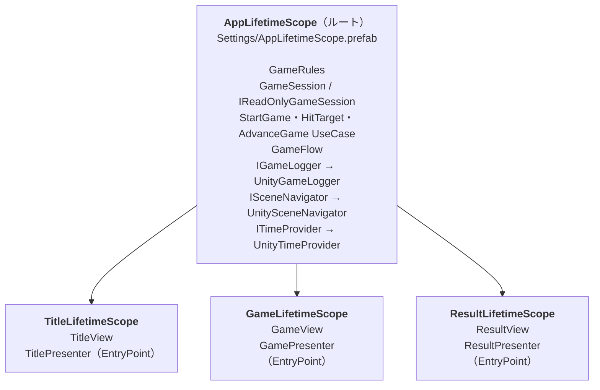

# DI とスコープ設計（VContainer）

DI コンテナには [VContainer](https://github.com/hadashiA/VContainer) を使っています（選定理由は [ADR-0002](adr/0002-use-vcontainer.md)）。

## スコープの構成



シーンのスコープは、自分に登録されていない型を親（ルート）から解決します。たとえば `ResultPresenter` は、ルートにある `IReadOnlyGameSession` と `GameFlow`、自分のスコープにある `ResultView` を受け取ります。

## ルートとシーンのどちらに置くか

判断の基準は**シーンをまたいで生き続ける必要があるか**です。

| 置き場所 | 基準 | 例 |
|---|---|---|
| ルート | シーンをまたいで状態を持つ、またはアプリ全体で1つでよい | `GameSession`（Game のスコアを Result で表示する）、`GameFlow`（遷移中フラグを持つ）、Port の実装 |
| シーン | そのシーンの中でしか意味を持たない | View（シーン上の MonoBehaviour）、Presenter |

`GameSession` をルートに置くことで、シーン間の値の受け渡しに static 変数や `DontDestroyOnLoad` のオブジェクトを使わずに済んでいます（[ADR-0005](adr/0005-keep-game-state-in-root-scope.md)）。

## ルートスコープの読み込み方

`Assets/Game/Settings/VContainerSettings.asset` の `RootLifetimeScope` に `AppLifetimeScope.prefab` を指定しています。VContainer はゲーム起動時にこの prefab を生成して `DontDestroyOnLoad` にします。

- 各シーンの `LifetimeScope` は `parentReference` を空にしているので、自動的にこのルートが親になります。
- どのシーンから再生しても、ルートが必ず先に用意されます。開発中に Game シーンを直接再生しても動きます。

## Presenter を MonoBehaviour にしない

Presenter は普通の C# クラスで、`RegisterEntryPoint` で登録します（[ADR-0004](adr/0004-plain-csharp-presenters.md)）。

```csharp
// GameLifetimeScope
builder.RegisterComponent<GameView>(view);
builder.RegisterEntryPoint<GamePresenter>();
```

VContainer のインターフェースで Unity のライフサイクルに参加します。

| インターフェース | 呼ばれるタイミング | 使っている Presenter |
|---|---|---|
| `IStartable.Start()` | スコープの構築後 | すべて（ボタンの購読、初期表示） |
| `ITickable.Tick()` | 毎フレーム（`Update` 相当） | `GamePresenter`（時間を進める） |
| `IDisposable.Dispose()` | スコープの破棄時（シーンを抜けるとき） | すべて（ボタンの購読解除） |

View はシーン上の参照を保持して表示を更新するだけの、薄い MonoBehaviour です。

```
View（MonoBehaviour）          Presenter（C# クラス）
  ボタン・テキストの参照  ◀──   UseCase を呼び、結果を View に反映
  SetScore / SetTime など        IReadOnlyGameSession を読む
```

Presenter がコンストラクタで依存を受け取るので、テストでは `new` するだけで組み立てられます。

## ライフタイムと破棄のタイミング

ルートの登録はすべて `Lifetime.Singleton` です。このアプリでは、どれもアプリ全体で1つあれば十分で、状態を持つもの（`GameSession`, `GameFlow`）は1つでなければいけないためです。

| オブジェクト | 生成 | 破棄 |
|---|---|---|
| ルートの Singleton | 最初に必要になったとき | ルートスコープの破棄時（アプリ終了時） |
| Presenter | シーンのスコープ構築時 | シーンを抜けるとき |

`GameFlow` は `IDisposable` を実装しているので、アプリ終了時に VContainer が `Dispose()` を呼びます。これが[シーン遷移のキャンセル](async-and-cancellation.md)のきっかけになります。

## DI 構成のテスト

DI の設定ミス（登録漏れ、Singleton でない、別のインスタンスが渡る）は実行するまで分からないことが多いので、[`AppLifetimeScopeTests`](../UnityProject/Assets/Game/Tests/EditMode/Bootstrap/AppLifetimeScopeTests.cs) で検査しています。

- `VContainerSettings` のルートが `AppLifetimeScope.prefab` を指しているか
- 登録したすべての型が解決でき、2回解決すると同じインスタンスが返るか
- `GameSession` と `IReadOnlyGameSession` が**同じインスタンス**か（ずれると Result 画面がスコア 0 の別のセッションを読んでしまう）
- `GameRules` が prefab に設定した `GameConfigAsset` の値になっているか

`LifetimeScope.Build()` は Play モードを前提にした処理を含むため、テストでは prefab の `Configure` だけをリフレクションで呼び、素の `ContainerBuilder` で組み立てています。こうすると EditMode で実際の prefab の設定を検証できます。
